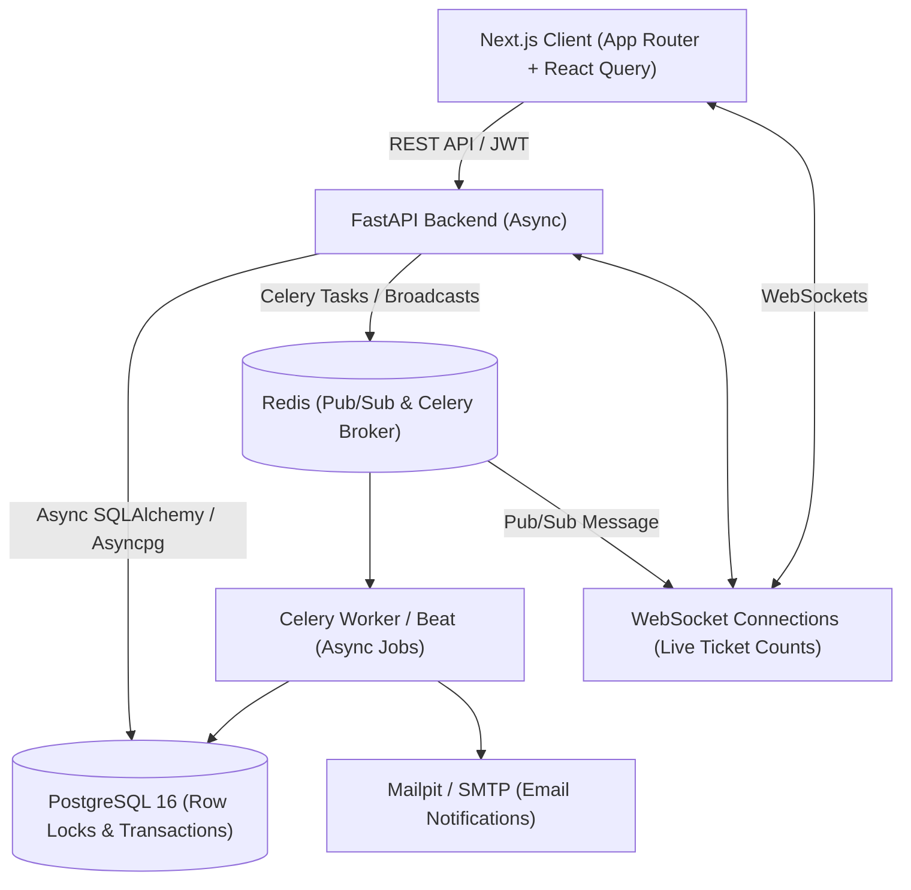

# EventDesk Architecture Overview

## 1. System Overview

EventDesk is a distributed event management platform engineered for strict data integrity under concurrent loads, asynchronous background processing, and real-time client updates.

---

## 2. Component Boundaries & Responsibilities

1. **Frontend (Next.js 14+ / TypeScript)**:
   - Client and server component rendering via App Router.
   - Authentication token handling (short-lived access tokens, refresh token rotation).
   - Real-time WebSocket subscriptions for event ticket counters.
   - Responsive UI components using Tailwind CSS and shadcn/ui.

2. **API Layer (FastAPI)**:
   - REST endpoints with Pydantic v2 validation.
   - Dependency injection for database sessions (`get_db`) and role-based permissions (`get_current_user`, `require_role`).
   - Concurrency-safe service layer holding transactional boundaries.
   - OpenAPI schema generation triggering automatic client type updates.

3. **Data Layer (PostgreSQL 16 & SQLAlchemy 2.0)**:
   - ACID transactions with `SELECT ... FOR UPDATE` row-level locks on event ticket allocation.
   - Hashed refresh tokens, Argon2 password hashes.
   - Soft-delete semantics (`deleted_at IS NULL`) enforced across all primary entity queries.

4. **Message Broker & Cache (Redis)**:
   - Task queue for Celery.
   - Pub/Sub engine to fan-out live ticket availability updates across FastAPI WebSocket workers.

5. **Background Jobs (Celery & Celery Beat)**:
   - Asynchronous email notifications (post-transaction commit).
   - Scheduled reminder tasks (e.g., 24 hours before event start).
   - Auto-completion of finished events.
