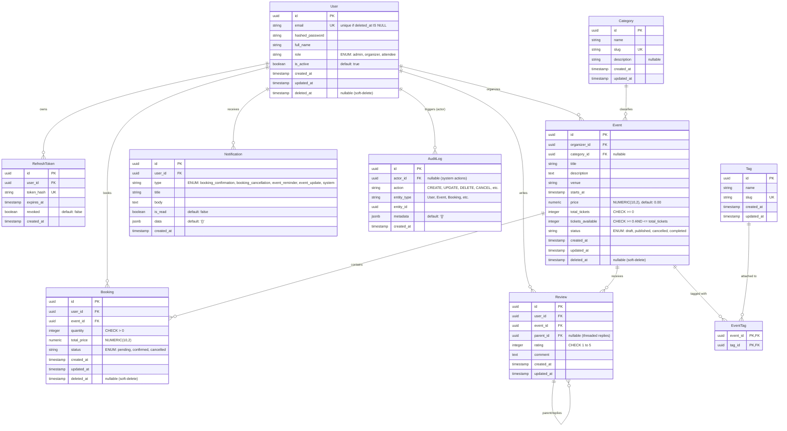

# Entity Relationship Diagram (ERD)



---

## Key Rules & Constraints

1. **Soft Delete**:
   - `User`, `Event`, and `Booking` models use `deleted_at`.
   - The unique index on `User.email` is partial (`WHERE deleted_at IS NULL`), allowing reuse of emails if an account is soft-deleted.
2. **Concurrency Invariants**:
   - `Event.tickets_available`: `CHECK (tickets_available >= 0 AND tickets_available <= total_tickets)`.
   - `Event.total_tickets`: `CHECK (total_tickets >= 0)`.
   - `Event.price`: `CHECK (price >= 0)`.
   - Concurrency control: Ticket booking operations acquire an exclusive row-level lock:
     ```sql
     SELECT * FROM events WHERE id = :event_id FOR UPDATE;
     ```
3. **Data Integrity & Ratings**:
   - `Review.rating`: `CHECK (rating >= 1 AND rating <= 5)`.
   - `Booking.quantity`: `CHECK (quantity > 0)`.
   - `Booking.total_price`: `CHECK (total_price >= 0)`.
4. **Audit Trail**:
   - Critical domain events (create/update event, create/cancel booking, role alteration) insert records into `audit_logs` **after** successful transaction commit.
5. **Common Indexes**:
   - `uq_users_active_email` on `users(email) WHERE deleted_at IS NULL`
   - `ix_users_role_active` on `users(role, is_active) WHERE deleted_at IS NULL`
   - `ix_refresh_tokens_user_revoked` on `refresh_tokens(user_id, revoked, expires_at)`
   - `ix_events_active_catalog` on `events(status, starts_at) WHERE deleted_at IS NULL`
   - `ix_events_organizer_id` on `events(organizer_id) WHERE deleted_at IS NULL`
   - `ix_events_category_id` on `events(category_id) WHERE deleted_at IS NULL`
   - `ix_bookings_user_active` on `bookings(user_id, created_at DESC) WHERE deleted_at IS NULL`
   - `ix_bookings_event_status` on `bookings(event_id, status) WHERE deleted_at IS NULL`
   - `ix_reviews_event_parent` on `reviews(event_id, parent_id, created_at DESC)`
   - `ix_notifications_user_unread` on `notifications(user_id, is_read, created_at DESC)`
   - `ix_audit_logs_entity` on `audit_logs(entity_type, entity_id)`
   - `ix_audit_logs_actor_created` on `audit_logs(actor_id, created_at DESC)`
