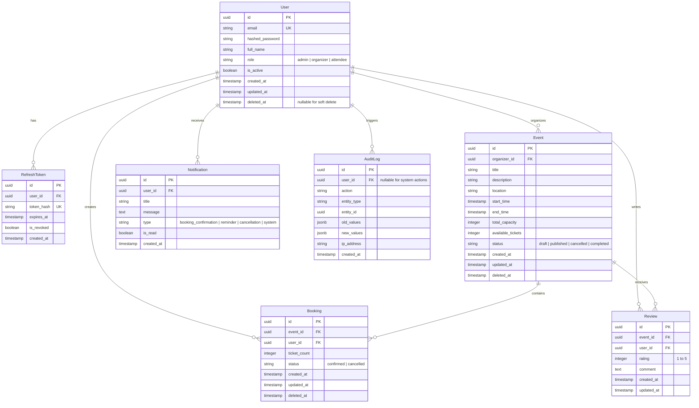

# Entity Relationship Diagram (ERD)

## Key Rules & Constraints
1. **Soft Delete**: `User`, `Event`, and `Booking` have `deleted_at`. Unique index on `User.email` must be conditional (`WHERE deleted_at IS NULL`) so deleted emails can be re-registered if desired.
2. **Concurrency Invariants**:
   - `Event.available_tickets >= 0`. Check constraint: `CHECK (available_tickets >= 0)`.
   - Booking service acquires a row lock: `SELECT * FROM events WHERE id = :event_id FOR UPDATE`.
3. **Audit Trail**: Every state change in `Event` and `Booking` must generate an `AuditLog` entry.
