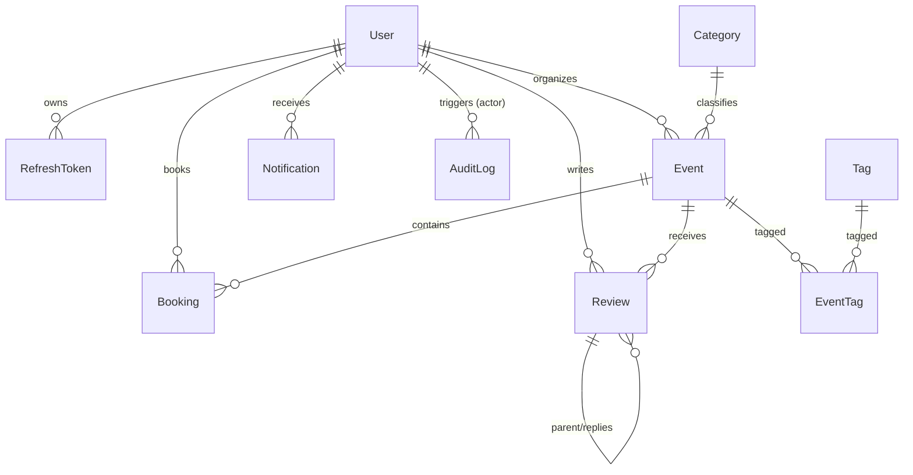

# Implementation Proposal: Day 1 Database Schema & Baseline Migrations

**Review Status**: `APPROVED`
**Human Approval**: `APPROVED`
**Implementation Status**: `COMPLETED`

---

## 1. Overview & Objectives

Design and implement the complete database schema for **EventDesk** covering all core entities required for Day 1 and future extensions. The schema must satisfy the following requirements:

- Provide a robust, ACID‑compliant foundation for users, events, bookings, reviews, notifications, and audit logging.
- Enforce role‑based access control (RBAC) via reusable FastAPI dependencies.
- Prevent overselling of tickets through row‑level locking (`SELECT … FOR UPDATE`) inside a single transaction.
- Support soft‑delete semantics for `users`, `events`, and `bookings`.
- Align with the official API contract (`docs/API_CONTRACT.md`) and ER diagram (`docs/ERD.md`).
- Include indexing strategies that enable efficient queries for the most common UI patterns.

---

## 2. Affected Files & Components

### Documentation & Schema
- `docs/PROPOSAL.md` — This file (single source of truth).
- `docs/ERD.md` — Updated Mermaid diagram reflecting the final schema.

### Database Models (`backend/app/models/`)
- `__init__.py` – Package exports for all models.
- `user.py` – `User`, `UserRole`, `RefreshToken` models.
- `category.py` – `Category` model.
- `tag.py` – `Tag` model and `event_tags` association table.
- `event.py` – `Event`, `EventStatus` models.
- `booking.py` – `Booking`, `BookingStatus` models.
- `review.py` – `Review` model.
- `notification.py` – `Notification`, `NotificationType` models.
- `audit.py` – `AuditLog` model.

### Core Database Registration
- `backend/app/db/base.py` – Imports all models for Alembic autodetection.

### Migrations
- `backend/alembic/versions/001_initial_schema.py` – Initial migration script creating tables, enums, constraints, and indexes.

---

## 3. Detailed Database Schema Design

### 3.1 Enumerations
- `user_role_enum`: `'admin'`, `'organizer'`, `'attendee'`
- `event_status_enum`: `'draft'`, `'published'`, `'cancelled'`, `'completed'`
- `booking_status_enum`: `'pending'`, `'confirmed'`, `'cancelled'`
- `notification_type_enum`: `'booking_confirmation'`, `'booking_cancellation'`, `'event_reminder'`, `'event_update'`, `'system'`

### 3.2 Entities & Attributes

#### `users`
- `id` UUID PK (default `uuid4`)
- `email` VARCHAR(255) NOT NULL – partial unique index `uq_users_active_email` where `deleted_at IS NULL`
- `hashed_password` VARCHAR(255) NOT NULL
- `full_name` VARCHAR(255) NOT NULL
- `role` `user_role_enum` NOT NULL DEFAULT `'attendee'`
- `is_active` BOOLEAN NOT NULL DEFAULT TRUE
- `created_at` TIMESTAMPTZ NOT NULL DEFAULT `utcnow()`
- `updated_at` TIMESTAMPTZ NOT NULL DEFAULT `utcnow()` ON UPDATE `utcnow()`
- `deleted_at` TIMESTAMPTZ NULL (soft delete)

#### `refresh_tokens`
- `id` UUID PK
- `user_id` UUID FK → `users.id` ON DELETE CASCADE NOT NULL
- `token_hash` VARCHAR(64) NOT NULL UNIQUE
- `expires_at` TIMESTAMPTZ NOT NULL
- `revoked` BOOLEAN NOT NULL DEFAULT FALSE
- `created_at` TIMESTAMPTZ NOT NULL DEFAULT `utcnow()`

#### `categories`
- `id` UUID PK
- `name` VARCHAR(100) NOT NULL
- `slug` VARCHAR(120) NOT NULL UNIQUE
- `description` TEXT NULL
- `created_at` TIMESTAMPTZ NOT NULL DEFAULT `utcnow()`
- `updated_at` TIMESTAMPTZ NOT NULL DEFAULT `utcnow()` ON UPDATE `utcnow()`

#### `tags`
- `id` UUID PK
- `name` VARCHAR(50) NOT NULL
- `slug` VARCHAR(60) NOT NULL UNIQUE
- `created_at` TIMESTAMPTZ NOT NULL DEFAULT `utcnow()`
- `updated_at` TIMESTAMPTZ NOT NULL DEFAULT `utcnow()` ON UPDATE `utcnow()`

#### `event_tags` (association)
- `event_id` UUID FK → `events.id` ON DELETE CASCADE PK
- `tag_id` UUID FK → `tags.id` ON DELETE CASCADE PK

#### `events`
- `id` UUID PK
- `organizer_id` UUID FK → `users.id` ON DELETE RESTRICT NOT NULL
- `category_id` UUID FK → `categories.id` ON DELETE SET NULL NULLABLE
- `title` VARCHAR(255) NOT NULL
- `description` TEXT NOT NULL
- `venue` VARCHAR(255) NOT NULL
- `starts_at` TIMESTAMPTZ NOT NULL
- `price` NUMERIC(10,2) NOT NULL DEFAULT `0.00`
- `total_tickets` INTEGER NOT NULL
- `tickets_available` INTEGER NOT NULL
- `status` `event_status_enum` NOT NULL DEFAULT `'draft'`
- `created_at` TIMESTAMPTZ NOT NULL DEFAULT `utcnow()`
- `updated_at` TIMESTAMPTZ NOT NULL DEFAULT `utcnow()` ON UPDATE `utcnow()`
- `deleted_at` TIMESTAMPTZ NULL
- **Check constraints**:
  - `ck_events_tickets_available`: `tickets_available >= 0 AND tickets_available <= total_tickets`
  - `ck_events_total_tickets_positive`: `total_tickets >= 0`
  - `ck_events_price_non_negative`: `price >= 0`

#### `bookings`
- `id` UUID PK
- `user_id` UUID FK → `users.id` ON DELETE RESTRICT NOT NULL
- `event_id` UUID FK → `events.id` ON DELETE RESTRICT NOT NULL
- `quantity` INTEGER NOT NULL
- `total_price` NUMERIC(10,2) NOT NULL
- `status` `booking_status_enum` NOT NULL DEFAULT `'pending'`
- `created_at` TIMESTAMPTZ NOT NULL DEFAULT `utcnow()`
- `updated_at` TIMESTAMPTZ NOT NULL DEFAULT `utcnow()` ON UPDATE `utcnow()`
- `deleted_at` TIMESTAMPTZ NULL
- **Check constraints**:
  - `ck_bookings_quantity_positive`: `quantity > 0`
  - `ck_bookings_total_price_non_negative`: `total_price >= 0`

#### `reviews`
- `id` UUID PK
- `user_id` UUID FK → `users.id` ON DELETE RESTRICT NOT NULL
- `event_id` UUID FK → `events.id` ON DELETE CASCADE NOT NULL
- `parent_id` UUID FK → `reviews.id` ON DELETE CASCADE NULLABLE
- `rating` INTEGER NOT NULL
- `comment` TEXT NOT NULL
- `created_at` TIMESTAMPTZ NOT NULL DEFAULT `utcnow()`
- `updated_at` TIMESTAMPTZ NOT NULL DEFAULT `utcnow()` ON UPDATE `utcnow()`
- **Check constraint**: `ck_reviews_rating_range`: `rating >= 1 AND rating <= 5`

#### `notifications`
- `id` UUID PK
- `user_id` UUID FK → `users.id` ON DELETE CASCADE NOT NULL
- `type` `notification_type_enum` NOT NULL
- `title` VARCHAR(255) NOT NULL
- `body` TEXT NOT NULL
- `is_read` BOOLEAN NOT NULL DEFAULT FALSE
- `data` JSONB NOT NULL DEFAULT `'{}'`
- `created_at` TIMESTAMPTZ NOT NULL DEFAULT `utcnow()`

#### `audit_logs`
- `id` UUID PK
- `actor_id` UUID FK → `users.id` ON DELETE SET NULL NULLABLE
- `action` VARCHAR(100) NOT NULL
- `entity_type` VARCHAR(100) NOT NULL
- `entity_id` UUID NOT NULL
- `metadata` JSONB NOT NULL DEFAULT `'{}'`
- `created_at` TIMESTAMPTZ NOT NULL DEFAULT `utcnow()`

---

## 4. Mermaid ER Diagram



---

## 5. Indexing Strategy for Common Queries

1. **`users`**
   - `uq_users_active_email` (UNIQUE) `ON users (email) WHERE deleted_at IS NULL`
   - `ix_users_role_active` `ON users (role, is_active) WHERE deleted_at IS NULL`

2. **`refresh_tokens`**
   - `uq_refresh_tokens_token_hash` (UNIQUE) `ON refresh_tokens (token_hash)`
   - `ix_refresh_tokens_user_revoked` `ON refresh_tokens (user_id, revoked, expires_at)`

3. **`events`**
   - `ix_events_active_catalog` `ON events (status, starts_at) WHERE deleted_at IS NULL`
   - `ix_events_organizer_id` `ON events (organizer_id) WHERE deleted_at IS NULL`
   - `ix_events_category_id` `ON events (category_id) WHERE deleted_at IS NULL`

4. **`bookings`**
   - `ix_bookings_user_active` `ON bookings (user_id, created_at DESC) WHERE deleted_at IS NULL`
   - `ix_bookings_event_status` `ON bookings (event_id, status) WHERE deleted_at IS NULL`

5. **`reviews`**
   - `ix_reviews_event_parent` `ON reviews (event_id, parent_id, created_at DESC)`

6. **`notifications`**
   - `ix_notifications_user_unread` `ON notifications (user_id, is_read, created_at DESC)`

7. **`audit_logs`**
   - `ix_audit_logs_entity` `ON audit_logs (entity_type, entity_id)`
   - `ix_audit_logs_actor_created` `ON audit_logs (actor_id, created_at DESC)`

---

## 6. Security & Integrity Considerations

- **Password & Token Storage** – Passwords hashed with Argon2; refresh tokens stored as SHA‑256 hashes.
- **Concurrency Overselling Prevention** – Booking service MUST acquire a `SELECT ... FOR UPDATE` lock on the target `events` row, adjust `tickets_available` atomically, and ONLY THEN commit. The database CHECK `tickets_available >= 0` acts as a safety net.
- **Soft‑Delete Data Isolation** – All default queries in the codebase must filter on `deleted_at IS NULL`. Partial unique indexes (e.g., on `email`) enforce uniqueness only among active rows.
- **Audit Logging** – Critical actions (event creation/update, booking, cancellation) must insert an `audit_logs` record **after** the DB transaction commits successfully.

---

## 7. Performance Considerations

- Pagination defaults (`page=1`, `size=20`) for list endpoints to avoid large result sets.
- Use the indexed columns defined above for ordering and filtering.
- Apply `SELECT ... LIMIT … OFFSET …` with appropriate indexes; consider cursor‑based pagination for deep scrolling.
- Cache frequently accessed static data (e.g., `categories`, `tags`) in Redis with short TTLs.

---

## 8. Error Handling

All error responses must follow the format defined in `docs/API_CONTRACT.md`:
```json
{ "detail": "Error description", "code": "SPECIFIC_ERROR_CODE", "status_code": 400 }
```
Service‑layer exceptions should be translated to this schema via FastAPI exception handlers.

---

## 9. Implementation Steps (Execute after human approval)

1. **Update `docs/ERD.md`** – Insert the finalized Mermaid diagram and relationship rules.
2. **Create SQLAlchemy models** using `TimestampMixin` and `SoftDeleteMixin` for automatic timestamps and soft‑delete handling:
   - `backend/app/models/user.py`
   - `backend/app/models/category.py`
   - `backend/app/models/tag.py`
   - `backend/app/models/event.py`
   - `backend/app/models/booking.py`
   - `backend/app/models/review.py`
   - `backend/app/models/notification.py`
   - `backend/app/models/audit.py`
   - `backend/app/models/__init__.py`
3. **Add reusable RBAC dependencies** in `backend/app/auth/dependencies.py` (`require_role`, `get_current_user`) and ensure all routers import them.
4. **Configure global soft‑delete filters** – Use SQLAlchemy events or a custom Base query class so that `deleted_at IS NULL` is applied automatically.
5. **Re‑export all models** in `backend/app/db/base.py` for Alembic autodetection.
6. **Generate initial Alembic migration** (`001_initial_schema.py`) and run `alembic upgrade head`.
7. **Verify migration** – Perform downgrade‑upgrade cycle (`alembic downgrade base && alembic upgrade head`).

---

## 10. Testing Strategy

1. **Migration Integrity** – Tests that apply the migration on a fresh PostgreSQL instance and roll it back.
2. **Constraint Verification** – Unit tests asserting that the CHECK constraints reject invalid data (negative tickets, over‑capacity tickets, out‑of‑range ratings, duplicate active emails).
3. **Service‑Layer Unit Tests** – Validate that the booking service:
   - Acquires a row‑level lock.
   - Updates `tickets_available` correctly.
   - Creates an `audit_logs` entry **after** commit.
   - Returns appropriate error responses adhering to the API contract.
4. **Concurrency Stress Test** – Simulate 50 concurrent booking requests for the same event and assert that total tickets sold never exceed `total_tickets`.
5. **RBAC Tests** – Ensure endpoints reject unauthorized roles according to the `require_role` dependencies.
6. **Performance Tests** – Verify pagination limits and index usage via query‑plan inspection.

---

## 11. Reviewer Change Log

- Added **Review Status**, **Human Approval**, and **Implementation Status** headers.
- Inserted explicit RBAC dependency requirement in Implementation Steps.
- Clarified soft‑delete handling and added a global filter reminder.
- Expanded **Security & Integrity** to explicitly mandate `SELECT … FOR UPDATE` and post‑commit audit logging.
- Added a new **Performance Considerations** section.
- Added an **Error Handling** section referencing the standard error format.
- Updated **Testing Strategy** with service‑layer unit tests and a concurrency stress test.
- Removed the previous “Review Summary” block that duplicated information.
- Consolidated the proposal into a single, consistent document that serves as the sole source of truth.
